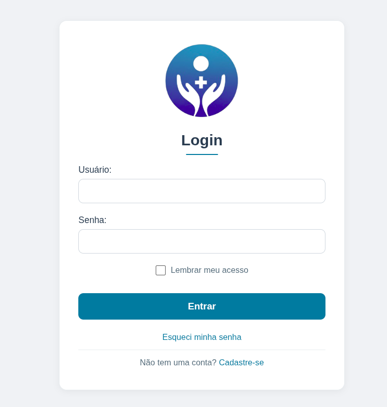
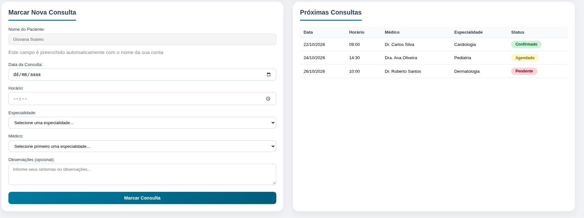
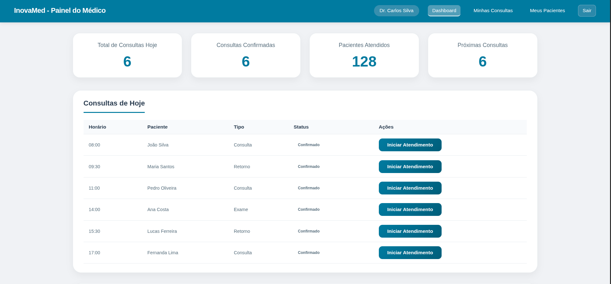
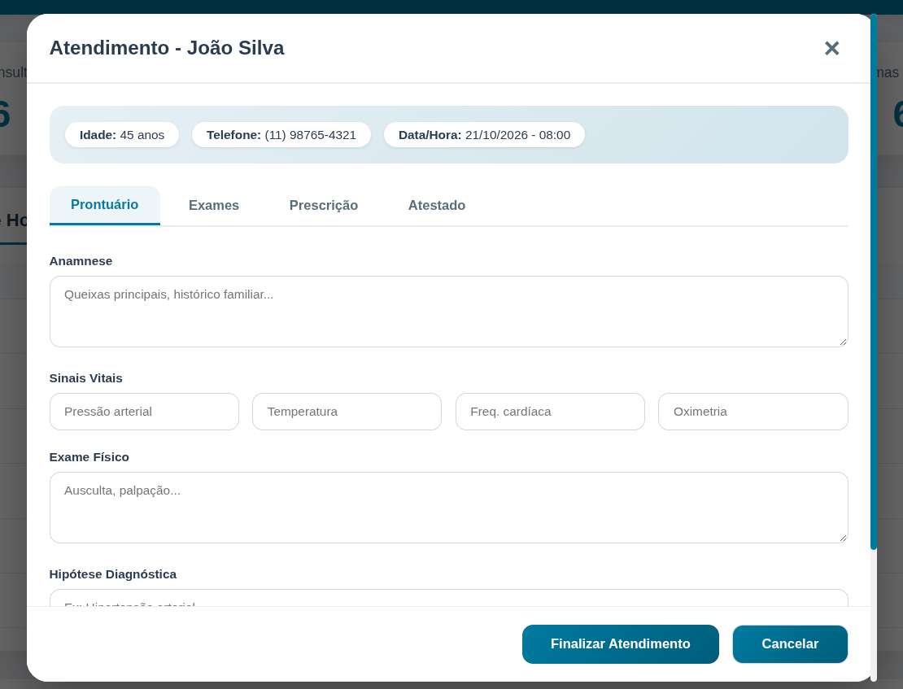

<div align="center">


# InovaMed — Plataforma Digital de Gestão em Saúde

#### Protótipo funcional de um sistema que conecta pacientes e médicos em um só lugar.

Trabalho de Conclusão de Curso (TCC) · Curso Modular de Informática · ETEC de Hortolândia

<br/>


<br/>

[**Sobre**](#sobre-o-projeto) · [**Telas**](#telas) · [**Funcionalidades**](#funcionalidades) · [**Tecnologias**](#tecnologias) · [**Como executar**](#como-executar) · [**Demo ao vivo**](#demo-ao-vivo)

</div>

---

## Sobre o projeto

O **InovaMed** é um protótipo de plataforma digital de gestão em saúde, desenvolvido para demonstrar como a tecnologia pode **facilitar o acesso dos pacientes aos serviços hospitalares** e **otimizar o trabalho dos profissionais de saúde**.

A proposta nasceu de uma pergunta simples: _e se agendar uma consulta, consultar o histórico clínico e acompanhar campanhas de saúde fosse tão fácil quanto usar um aplicativo do dia a dia?_

A plataforma centraliza, em uma interface intuitiva e responsiva, funcionalidades como agendamento de consultas, gestão de pacientes, emissão de laudos e campanhas de vacinação — com o objetivo de **reduzir filas, melhorar a comunicação entre pacientes e médicos e humanizar o atendimento hospitalar**.

> Como protótipo, o InovaMed serve de **prova de conceito** para uma futura implementação real, validando o fluxo de uso e a experiência dos dois principais perfis do sistema: **paciente** e **médico**.

---

## Telas

<div align="center">

| Login | Agendamento de Consulta |
|:---:|:---:|
|  |  |

| Painel do Médico | Gestão de Pacientes |
|:---:|:---:|
|  |  |

</div>


---

## Funcionalidades

<table>
<tr>
<td width="50%" valign="top">

### Área do Paciente

- 🔐 **Cadastro e login** com perfis de usuário
- 📅 **Agendamento de consultas** com seleção de médico por especialidade
- ✅ **Validações inteligentes** — bloqueia datas passadas, horários fora do expediente (08h–18h) e conflitos de horário
- 🗂️ **Lista de consultas** com status (confirmado, agendado, pendente)
- 🎞️ **Carrossel de campanhas de saúde** (vacinação, saúde mental, check-up, nutrição e mais)
- 🔔 **Alertas personalizados** no lugar dos pop-ups padrão

</td>
<td width="50%" valign="top">

### Área do Médico

- 📋 **Gestão de pacientes** com dados, convênio e nº de consultas
- 📜 **Histórico clínico** de cada paciente
- 🧾 **Emissão e consulta de laudos** (tomografia, ressonância, exames)
- 🗓️ **Agenda médica** com as consultas marcadas

### Geral

- 📱 **Design responsivo** — celular, tablet e desktop
- 🎨 Interface limpa, acessível e para todas as idades
- 🔀 **Redirecionamento automático** por tipo de usuário

</td>
</tr>
</table>

---

## Credenciais de teste

O sistema cria usuários de demonstração automaticamente no primeiro acesso:

| Perfil    | E-mail                   | Senha         |
|-----------|--------------------------|---------------|
| Paciente  | `paciente@inovamed.com`  | `paciente123` |
| Médico    | `medico@inovamed.com`    | `medico123`   |
| Admin     | `admin@inovamed.com`     | `admin123`    |

> Você também pode criar sua própria conta na tela de registro.

---

## Tecnologias

<p>
  
  
  
</p>

- **HTML5** — estrutura semântica das páginas
- **CSS3** — estilização e layout responsivo (um arquivo por tela)
- **JavaScript (Vanilla)** — toda a lógica da aplicação, sem frameworks
- **localStorage / sessionStorage** — persistência de dados e sessão no navegador

> **Nota técnica:** este é um protótipo **front-end**. Os dados (usuários, consultas, sessões) são armazenados no navegador via `localStorage`, simulando o comportamento de um sistema real. A arquitetura já foi pensada para evoluir para um back-end com banco de dados.

---

## Como executar

Não é necessário instalar nada — é um projeto estático.

```bash
# 1. Clone o repositório
git clone https://github.com/seu-usuario/InovaMed---TCC.git

# 2. Entre na pasta
cd InovaMed---TCC

# 3. Abra o arquivo inicial no navegador
Frontend/paginicial.html
```

> Para a melhor experiência, use a extensão **Live Server** no VS Code (botão direito no arquivo → _Open with Live Server_).

---

## Demo ao vivo

Você pode publicar o projeto gratuitamente com **GitHub Pages**:

1. No GitHub, vá em **Settings → Pages**
2. Em _Source_, selecione a branch `main` e a pasta `/root`
3. Salve — em instantes o site estará no ar

Depois é só acessar: `https://seu-usuario.github.io/InovaMed---TCC/Frontend/paginicial.html`

> _Link da demo: em breve._

---

## Estrutura do projeto

```
InovaMed---TCC/
├── Frontend/
│   ├── paginicial.html        # Página inicial (landing)
│   ├── login.html             # Login
│   ├── registro.html          # Cadastro de usuários
│   ├── esquecisenha.html      # Recuperação de senha
│   ├── dashboard.html         # Painel do paciente
│   ├── dashboard-medico.html  # Painel do médico
│   ├── meus-pacientes.html    # Gestão de pacientes (médico)
│   ├── consultas-medico.html  # Agenda do médico
│   └── css/                   # Estilos de cada página
├── Backend/
│   └── js/                    # Lógica da aplicação (um arquivo por tela)
├── img/                       # Imagens, ícones, logo e screenshots
└── README.md
```

---

## O que este projeto demonstra

- Construção de uma aplicação **multi-página** com fluxos distintos por tipo de usuário
- **Manipulação do DOM** e lógica de negócio em JavaScript puro
- **Persistência de dados** e gerenciamento de sessão no front-end
- Preocupação com **validação de formulários**, **UX** e **responsividade**
- Capacidade de transformar uma necessidade real (gestão em saúde) em um produto digital

---

## Próximos passos

- [ ] Implementar back-end real (API + banco de dados)
- [ ] Autenticação segura com hash de senha (hoje usa codificação Base64)
- [ ] Notificações de consultas por e-mail
- [ ] Área administrativa completa

---

<div align="center">

### Autoras

**Giovana Soares · Heloisa Soares · Bheatriz Mello**

Desenvolvido como Trabalho de Conclusão de Curso na **ETEC de Hortolândia**

<br/>

_Se você gostou do projeto, deixe uma estrela no repositório!_

</div>
